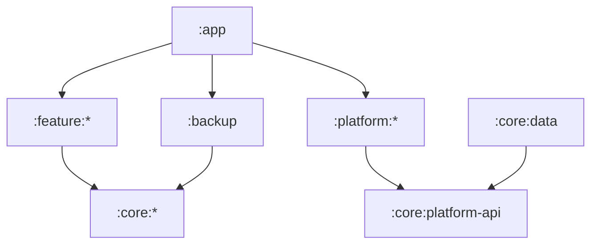

# Strata Launcher

A minimal, vertical-list Android home screen with a fully free, user-controlled theme system.

[](https://github.com/Nexusdeveloper902/strata-launcher/actions/workflows/ci.yml)
-3DDC84?logo=android&logoColor=white)


> [!NOTE]
> **No affiliation.** This project is not affiliated with, endorsed by, or derived
> from the source code of Niagara Launcher or its publisher. "Niagara Launcher"
> is named only as the subject of comparative research. The independent product
> uses its own name, branding, artwork, copy and code.

Strata is a personal, sideloaded project (package `app.strata.launcher`), tested mainly on a
Samsung Galaxy A56. It is **work in progress**: milestones M0 to M4 are merged, M5 is underway,
and there is no release yet.

## Features

What works today:

- **App list**: A-Z list of installed apps with an alphabet index.
- **Search**: fast on-device app search.
- **Home**: clock and date header, favourites block (with drag-to-reorder editing), and a home menu.
- **Gestures**: home gestures, including double-tap to lock the screen (Android 9+, via an opt-in
  accessibility service).
- **App management**: long-press sheet with app actions.
- **Themes**: a theme engine with strict, bounded parsing and validation, contrast enforcement,
  live theme switching, built-in themes, and a safe mode that falls back to the default theme
  after repeated failed starts.
- **Everything free** and **offline**: no accounts, no paywalls, no analytics, no network use.

## Roadmap

Details and definitions of done are in [`spec/IMPLEMENTATION_ROADMAP.md`](spec/IMPLEMENTATION_ROADMAP.md).

- [x] **M0**: scaffold, CI, quality gates
- [x] **M1**: app catalog and A-Z list
- [x] **M2**: search
- [x] **M3**: home, favourites, gestures, double-tap lock, app management
- [x] **M4**: theme engine and integration (live themes, safe mode, built-in themes)
- [ ] **M5**: theme UI, import/export, icons and icon packs *(in progress)*
- [ ] **M6**: onboarding, profiles, shortcuts
- [ ] **M7**: widgets, notification badges, contact search
- [ ] **M8**: complete settings, backup/restore, accessibility and i18n hardening
- [ ] **M9**: performance, reliability, compatibility, then v1 release

## Building and installing

Requirements: JDK 21 and the Android SDK with `platforms;android-36` and build-tools 36.1.0
(set `ANDROID_HOME` or `sdk.dir`). Use the Gradle wrapper:

```sh
./gradlew assembleDebug
```

The APK is written to `app/build/outputs/apk/debug/app-debug.apk`. Install it with
`adb install -r app/build/outputs/apk/debug/app-debug.apk`, then pick Strata as the home app.

CI also uploads the debug APK from every build as the `strata-debug-apk` artifact (kept 30 days).

## Tests and CI

[`ci.yml`](.github/workflows/ci.yml) runs on every pull request and on pushes to `main`:

| Check | What it covers |
|---|---|
| Build | Debug APK, androidTest APK, benchmark build |
| Unit and Robolectric tests | JVM tests, lint rules, build-logic gate tests |
| Android Lint | `lintDebug` |
| ktlint | Kotlin style |
| Static gates | `checkPermissions`, `checkDependencies`, `checkModuleGraph`, `checkEntitlements` |
| GMD smoke tests | Gradle Managed Device emulator smoke test on API 26, 34 and 36 |

Run the full check locally before pushing:

```sh
./gradlew assembleDebug testDebugUnitTest lintDebug ktlintCheck checkPermissions checkDependencies checkModuleGraph checkEntitlements assembleDebugAndroidTest :build-logic:convention:test
```

Tests are named by ID (`T-...`); the mapping to requirements is in
[`spec/REQUIREMENTS_TRACEABILITY.md`](spec/REQUIREMENTS_TRACEABILITY.md).

## Project layout

Module rules are in [`spec/ARCHITECTURE.md`](spec/ARCHITECTURE.md) and enforced by `checkModuleGraph`.



<details>
<summary>Module tree</summary>

| Module | Purpose |
|---|---|
| `:app` | Application, activities, manifest, manual DI, navigation host |
| `:core:common`, `:core:model`, `:core:json` | Pure Kotlin basics, domain models, strict bounded JSON |
| `:core:platform-api` | Interfaces for every platform service |
| `:core:theme` | Theme model, parser, validator, resolver, contrast, theme library |
| `:core:search` | Normaliser, index and ranker |
| `:core:data` | Repositories, Room, DataStore, theme file store |
| `:core:ui` | Design system and shared composables |
| `:platform:apps`, `:icons`, `:widgets`, `:notifications`, `:system` | Thin Android adapters |
| `:feature:home`, `:search`, `:widgets`, `:settings`, `:theme`, `:onboarding` | Screens |
| `:backup` | Backup codec and restore |
| `:testing:fakes`, `:testing:fixtures` | Fakes and test data |
| `:benchmark`, `:lint-rules`, `build-logic/` | Macrobenchmarks, custom lint, convention plugins |

</details>

## Documentation

- [`spec/`](spec/): product spec, architecture, Android platform notes, theme system, visual and
  interaction specs, roadmap, test plan, requirements traceability.
- [`spec/sample-themes/`](spec/sample-themes/) and [`spec/theme.schema.json`](spec/theme.schema.json): theme format samples and schema.
- [`docs/impl-notes/`](docs/impl-notes/): per-milestone implementation notes (M0 to M4).
- [`docs/perf/`](docs/perf/): performance notes.
- [`research/DECISIONS.md`](research/DECISIONS.md): recorded project decisions.

## Contributing

Every change goes through a pull request into `main`, squash-merged once CI is green. Enable the
local guard with `git config core.hooksPath tools/git-hooks`. See [`CONTRIBUTING.md`](CONTRIBUTING.md)
for branch names, commit messages and the clean-room rule.

## For coding agents

[`CLAUDE.md`](CLAUDE.md) and [`AGENTS.md`](AGENTS.md) are written for coding agents (rules,
reading order, environment notes). Humans can ignore them.
